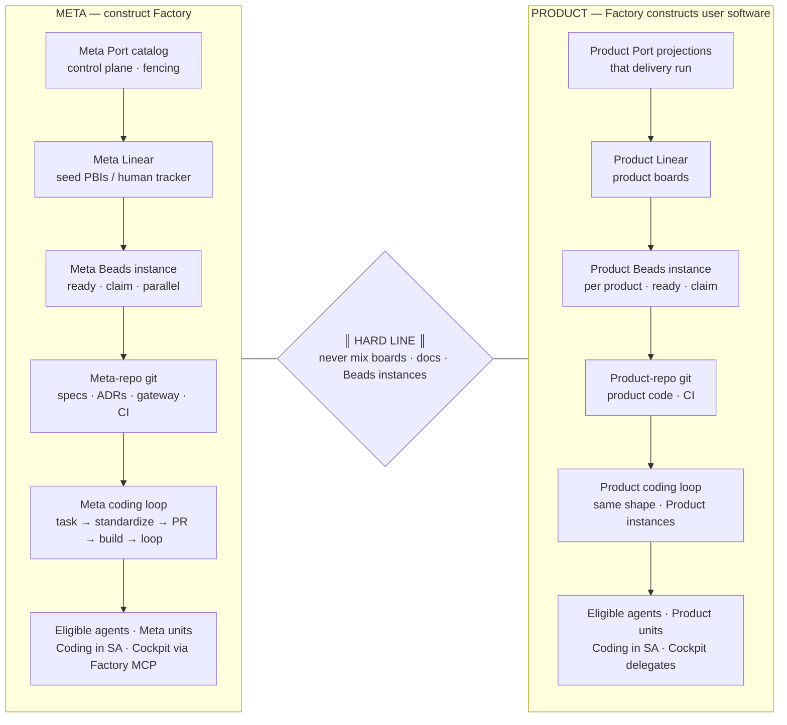
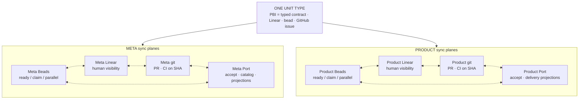
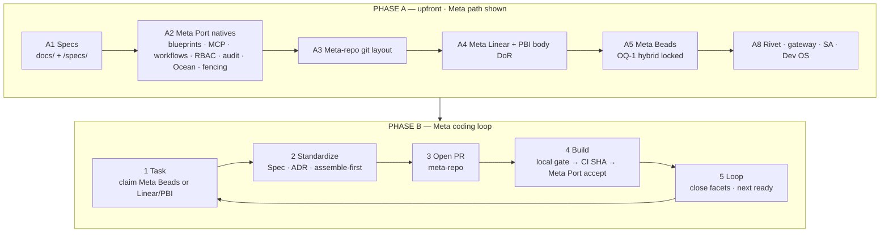
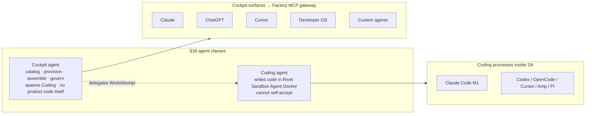

# Factory architecture map

**Status:** **Derived from** [`factory-master-spec.md`](./factory-master-spec.md) (§0.2 / §0.3 / §0.4 / §0.7 / §18). Not an independent SoT — master first, then propagate.  
**Date:** 2026-10-28  
**Lane rule:** Every box is **Meta** *xor* **Product** — never Both / shared / either (master [§0.2](./factory-master-spec.md#02-meta-xor-product); [`factory-meta-vs-product.md`](./factory-meta-vs-product.md)).

**Canonical SoT:** [`factory-master-spec.md`](./factory-master-spec.md)  
**Derived companions:** [`factory-workflow.md`](./factory-workflow.md) · [`factory-coding-loop.md`](./factory-coding-loop.md) · [`factory-meta-vs-product.md`](./factory-meta-vs-product.md)

**This write:** Diagrams + captions only. No Port / Linear / Notion mutations. No PBI execution.

---

## 1. Whole Factory — Meta left | hard line | Product right



**Caption:** Meta builds Factory (kernel Specs, seed PBIs, meta-repo, Meta Beads, Meta Port). Product is what Factory does when assembling a user project. Shapes rhyme; ownership must not ([meta-vs-product](./factory-meta-vs-product.md)).

---

## 2. Four-way sync — one unit type, lane-bound instances

One unit = five names: **typed contract ≡ PBI ≡ Linear ticket ≡ bead ≡ GitHub issue**. Facets sync across four planes. Beads planes are **two boxes** — Meta Beads vs Product Beads — never one shared Beads.



**Caption:** Creating/updating in one facet maps to the others **within the same lane**. Meta Beads never hosts a Product bead; Product Linear never is the meta board ([workflow § Sync model](./factory-workflow.md#sync-model--one-unit-of-work)).

---

## 3. Port upfront (Phase A) then coding loop (Phase B)

Port native setup is a **hard prerequisite** before Feature Assembly. Coding sequence is fixed and agent-agnostic.



**Caption:** Phase A stands up Meta control plane ([workflow Phase A](./factory-workflow.md#phase-a--upfront-setup-before-any-build--feature-assembly)). Phase B is the five-step Meta loop ([`factory-coding-loop.md`](./factory-coding-loop.md)). A Product run uses the same *shape* on Product Port / Product Linear / Product Beads / product-repo — separate doc when authored.

**Admit path (Meta):** Meta Port → webhook HMAC → factory-gateway → Rivet `ProjectSupervisor` → Sandbox Agent → Meta git → CI green on SHA → Meta Port accept ([master §13.0](./factory-master-spec.md#130-problem--goals--non-goals)).

---

## 4. Eligible agents — Coding vs Cockpit



**Caption:** Classes are locked in master [§18](./factory-master-spec.md); workflow lists them as eligible — Cursor is not the only coding agent ([workflow § Eligible agents](./factory-workflow.md#eligible-agents-already-defined--do-not-invent)). Polygraph / Trail-Code are **not** coding agents.

---

## 5. How a fresh agent enters

```mermaid
sequenceDiagram
  participant A as Fresh eligible agent
  participant Docs as Lane SoT docs
  participant Sync as Synced planes for that lane
  participant Loop as Coding loop

  A->>Docs: Read meta-vs-product · workflow · coding-loop · master
  A->>Docs: Pick lane Meta XOR Product — refuse if unclear
  A->>Sync: Read ready state (Beads claim when live; else Linear/PBI)
  alt Contract body incomplete
    A-->>A: Refuse start — DoR fail
  else Ready + typed contract complete
    A->>Sync: Atomic claim · take worktree · disjoint paths
    A->>Loop: task → standardize → PR → build → loop
    Note over A,Loop: Agent done ≠ Port accept · CI on exact SHA required
  end
```

**Caption:** Pickup reads **shared synced state**, not private memory ([workflow pickup rule](./factory-workflow.md#sync-model--one-unit-of-work)). Collision rules: one claim → one write set → no overlapping paths ([workflow collision](./factory-workflow.md#collision-avoidance--claims-worktrees-file-scope)).

---

## Quick legend

| Symbol | Meaning |
|--------|---------|
| **Meta** | Building Factory itself — this Project, seed PBIs, meta-repo, Meta Beads, Meta Port |
| **Product** | Factory assembling a user project — product boards, Product Beads, product repo, Product Port projections |
| **Hard line** | Never share Linear project, docs tree, or Beads instance across lanes |
| **Four planes** | Beads instance · Linear · git · Port — synced facets of one unit, **per lane** |

---

## Document control

| Doc | Role |
|-----|------|
| **This file** | **Derived** one-page visual map of Factory Meta vs Product + sync + loop + agents + entry |
| [`factory-meta-vs-product.md`](./factory-meta-vs-product.md) | **Derived** lane elaboration |
| [`factory-workflow.md`](./factory-workflow.md) | **Derived** Phase A setup, sync, agents/roster, collision |
| [`factory-coding-loop.md`](./factory-coding-loop.md) | **Derived** Meta five-step sequence |
| [`factory-master-spec.md`](./factory-master-spec.md) | **Single canonical SoT** — ADRs, §0.7 roster, §18, seed PBIs |
