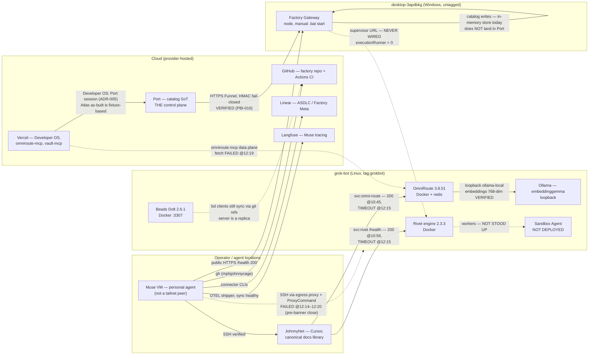

# Factory Machine & Service Inventory — PBI-022

**Unit:** PBI-022 ≡ Linear [STL-242](https://linear.app/johnny-cage/issue/STL-242) ≡ GitHub #135 · plan `plan-6d24c450`
**Lane:** Meta · **Agent:** Muse (personal-agent, Cockpit class) · **Mode:** read-only discovery — nothing was restarted, deployed, installed, or reconfigured.
**Observed:** 2026-10-31, 11:55–12:21 CDT (America/Chicago), five separated discovery lanes (Muse VM, grok-bot, JohnnyNet, desktop gateway host, cloud surfaces).
**Machine-readable twin:** [`factory-machine-service-inventory.json`](./factory-machine-service-inventory.json) (same records, typed per the STL-242 schema).
**Redaction (contract field 15):** this repo version carries no secret values and no tailnet IPs (shown as "tailnet — see private evidence"); only ports already documented in this public repo are named. The unredacted evidence set lives in the operator's private workspace (`factory-pbi-022-private`), and every claim below cites it.

**Verification vocabulary:** `verified` (checked live this run) · `configured_unverified` (configured per records, not live-checked) · `operator_reported` (operator records, dated) · `unreachable` (route exists, host did not answer) · `unknown`.

> **Headline:** The Factory runs on two personal Windows/Linux boxes and a cloud control plane — and on inventory day, one of the two boxes was down. Rivet, OmniRoute, and the Beads Dolt server all live on **grok-bot**, which dropped off the tailnet mid-inventory and had not verifiably recovered by close. The Gateway lives alone on **desktop-3apdbkg**, is publicly reachable and healthy, and is also carrying a critical, already-triaged exposure (unauthenticated privileged routes — PBI-023). The composed Port → Gateway → Rivet → Worker path has **never run end to end**: Port's `executionRunner` count is 0, the Gateway was never pointed at Rivet, the ProjectSupervisor was never stood up, and Sandbox Agent runs nowhere.

---

## 1. Executive topology: which computers/clouds exist and who owns them

Everything is owned and operated by **Johnny** (sole operator). There is no team, no managed cloud host, and no second admin. Four physical/host locations plus one cloud tier were inventoried:

| Location | What it is | Role in the Factory | State at inventory close |
|---|---|---|---|
| **Muse VM** (`htch-runtime`) | Muse's own computer — Ubuntu 24.04.5 VM, 4 vCPU / 7.7 GB RAM, ephemeral (replaced ~11:00 CDT on inventory day) | Browser/computer operator, tailnet discovery, cross-machine coordination, PR/Linear/GitHub work. **Explicitly NOT the production host** (STL-242 field 13) | Online, verified |
| **grok-bot** | Linux services box (tagged tailnet node) | Rivet engine, OmniRoute (+Ollama), Beads Dolt server — the entire self-hosted service tier | **Unreachable** — dropped between ~10:44 and 12:14 CDT; operator reported "back up" 12:16; agent-side checks still failed 12:20 (conflict R-01) |
| **JohnnyNet** ("Johhny-NET") | Operator's Windows 11 laptop — HP EliteBook x360 1040 G7, i7-10710U 6c/12t, 31.78 GB RAM | Windows development environment, Cursor + AgentStore canonical docs library, connectivity testing vantage | Online, verified (uptime ~17h24m) |
| **desktop-3apdbkg** | Windows desktop (untagged tailnet node) | Factory Gateway host + its public Funnel | Gateway service verified live (health 200); host itself never inspected (SSH blocked, R-06) |
| **Cloud** | Port, Vercel, GitHub, Linear, Langfuse, Turso, Tailscale control plane, Supermemory | Control plane (Port — the ONE control plane), source/CI (GitHub), tracking (Linear), app hosting (Vercel), observability (Langfuse), data (Turso), network (Tailscale) | Mostly verified live; **Port cited-only** (credential stale, R-05); Turso platform API blocked (403, R-07) |

Also on the tailnet, recorded so they are not silently omitted: **grokbot-box** (offline 9 days, stale) and **lead-box** (offline 22 h), plus unidentified active nodes (`muse-1`, `codex-environment-1/-4/-5`, `muse` offline) whose roles this inventory does not establish (R-12).

Two structural facts shape everything below:

1. **Two separate host-availability dependencies.** Execution/inference/storage sit on grok-bot; Port ingress sits on desktop-3apdbkg. Either box alone can halt the Factory (§4 models both failures).
2. **The Muse VM is not a tailnet peer.** It reaches tailnet hosts through the Hatch egress proxy plus a ProxyCommand SSH helper. Tailnet service (svc:) URLs cannot be curled from the VM at all — reachability verdicts for those routes come from JohnnyNet, a real tailnet client.

---

## 2. Per-machine installed software and services

### 2.1 Muse VM (`htch-runtime`) — verified 12:13–12:15 CDT

- **OS/resources:** Ubuntu 24.04.5 LTS, kernel 7.0.0-39-generic; 4 vCPU (AMD EPYC 9D25); 7.7 GiB RAM — **nearly exhausted at idle** (393 MiB available; the hatch daemon is the top consumer); disk 150 GB (123 GB free); **no GPU**.
- **Listening ports:** zero. Running processes of note: hatch daemon, hatch-execd, systemd. No user crontab exists (schedules are Hatch runtime crons, not enumerable from inside the VM).
- **Installed:** node v24.22.1, npm 10.9.4, git 2.43.0, python3 3.12.3, gh 2.102.0 (accounts: johnnyc-9164 active, skysthelimitpainting1779-collab, mplsjohnnycage), vercel 60.1.3 / convex 1.46.0 / turbo 2.11.4 (in `~/.npm-global/bin`, which is **not on the default PATH** — naive checks report them missing), turso CLI v1.0.34 (not logged in), bd 1.3.0, Codex bundle at `~/workspace/bin/codex-bundle/`.
- **Absent (drift vs standing records, R-14):** Docker binary entirely absent (older records said installed-but-unrunnable); the creative suite (Blender/Inkscape/GIMP, installed 2026-10-23) is gone. Cause: VM replacement — uptime at observation was 1h13m.
- **Factory checkouts:** `factory-pbi-016-src` (main @ ba4fbcb), worktree `factory-pbi-016` (PBI-016 branch state), this inventory's worktree `factory-pbi-022`, and `factory-plugin` (plain directory, not a git repo).
- **Services:** none. This machine hosts no Factory service and should not: it is ephemeral by design.

### 2.2 grok-bot — UNREACHABLE this run; last verified 10:43–10:56 CDT (operator records)

No on-box data could be collected: nine SSH attempts (12:14–12:20 CDT) all closed before banner exchange (see §8/R-01). What follows is the last verified state, marked as such — not presented as current:

- **Containers (up at ~10:43 CDT):** `factory-rivet-engine` (healthy), `omniroute` (healthy), `omniroute-redis` (healthy), `beads-dolt`. Docker is the process manager.
- **Tailscale:** userspace-networking install from a home-directory tools folder (custom socket), currently run as root via a supervise script; no systemd (PID 1 = tini). Serve state in the morning window: Funnel for the box's own name → OmniRoute dashboard/API port; `svc:omni-route` HTTPS → OmniRoute; `svc:rivet` HTTPS 443 → Rivet 6420; tcp 3307 → beads-dolt (the `svc:dolt` host advertisement; console definition still pending).
- **Also present (operator records):** host-local Ollama serving embeddings for OmniRoute; an on-box Codex was directed there on 2026-10-30; an unauthenticated Docker API listener on all interfaces (R-03).
- **Unknown because the host never answered:** OS/kernel, CPU/RAM/disk, uptime, CLI versions, current container state, when exactly it went down.

### 2.3 JohnnyNet (Johhny-NET) — verified 12:14–12:19 CDT

- **OS/hardware:** Windows 11 Pro, version 10.0.26300, build 26300; HP EliteBook x360 1040 G7; i7-10710U (6c/12t); 31.78 GB RAM; C: 202.0 GB used / **34.7 GB free** of ~236.7 GB. Last boot 2026-10-30 18:49:55 CDT. Tailscale 1.104.4.
- **Agent/dev tooling:** Cursor **3.27.22**; Codex CLI **0.164.0** (no Codex desktop app found); OpenCode desktop; VS Code; Notion; Docker Desktop **29.8.2** (WSL2); gh 2.103.2 (auth dead — §5), git 2.56.0, node v26.12.1, npm 11.20.0. A `.claude` profile directory exists — that does **not** establish a Claude Code install (§5, R-13).
- **Cursor AgentStore docs library** (the Factory master spec's source library): store bc-46618e13 `files\docs` = **231 files**; store bc-72015999 = **234 files** — up from the 210/213 recorded 2026-10-30 (drift flagged, R-09).
- **Checkouts:** `Development\Scratch\factory-recovery\factory-primary` — branch `cursor/fe198-ask-rivet-wiring`, HEAD af4bbd7 (FE-198 draft, unpushed and currently unpushable); `factory-second` (no commits); `Development\Projects\port-project-factory` (a separate app, not the meta repo). No checkout under `Projects\`.
- **Own Docker stack (NOT Factory):** 5 containers up ~17h — speaches STT (OpenCue), llama.cpp embedding server, utopia-app, utopia-codex-bridge, pgvector. Recorded to prevent misattribution: this is the operator's separate Utopia/OpenCue stack, not the execution tier. Ports are in the private evidence; most bind loopback, two bind all LAN interfaces.

### 2.4 desktop-3apdbkg — host UNVERIFIED (SSH blocked); gateway service verified

- **Verified live (public vantage, 12:14 CDT):** `GET /health` → 200 `{"ok":true,"service":"factory-gateway"}`; `GET /` → 404 JSON (no surface listing exposed); public DNS resolves only to Tailscale Funnel edge addresses (public record: 209.177.145.97, 209.177.145.192) — no origin IP leaks.
- **Not collected (blocked, R-06):** hostname confirmation, Windows version/build, uptime, CPU/RAM/disk, gateway process PID/start/command line, checkout state, launcher env names, listening ports, host-reported serve/Funnel status, Docker presence.
- **Operator records (2026-10-30, cited — not re-verified):** gateway = node.exe running `apps/factory-gateway/start-local.mjs`, launched by `start-factory-gateway.bat` (env set inline in the .bat; no .env file), checkout stale at f684dc7 (PR #46 era). Whether any of that is still true is unknown until the host is inspected once.

### 2.5 Cloud surfaces — verified live unless marked cited

| Surface | State | Evidence |
|---|---|---|
| GitHub `mplsjohnnycage/factory` | PUBLIC, main default; last push 2026-10-31 17:09Z (PR #134 merge); open PRs #120/#118/#117 (Claude Code), #110 (Codex); protection rule cited (85514694), not API-readable from the active account | cloud-surfaces §1 |
| Vercel (johnnyc account, 35 projects) | factory-developer-os **READY** (prod deploy at the PR #134 merge; public URL 200); omniroute-mcp READY; vault-mcp READY; website-buyer-intelligence READY; factory-meta-ci / factory-control-plane / factory-capabilities latest prod targets **CANCELED** (dead experiments). **CLI on the VM is logged out** — data read via REST token route | cloud-surfaces §2 |
| Linear (ASDLC) | 242 issues: Done 161 · Backlog 70 · Canceled 6 · Todo 2 · In Progress 2 · Duplicate 1. Wave: STL-230 Done; STL-232/234/236/238 Backlog; STL-239 **and** STL-240 both live for PBI-021; STL-242 Backlog | cloud-surfaces §3 |
| Langfuse (Factory org, EU) | Project `muse` reachable; tool-call sync healthy — watermark 908710, shipped_total 2528, updated 11:59 CDT (~15 min before observation). Known gap: modelId null via OTEL route (model ships in metadata) | cloud-surfaces §4 |
| Turso | **Platform API 403** — no live list. Cited 2026-10-23 map: website-buyer-intelligence (live; verified writes today), micro-opp-intelligence (persists, machine stopped), skys-prospects, secrets-vault | cloud-surfaces §5 |
| Port | **Cited only** (2026-10-30 census): org with 55 blueprints, 5 Ocean integrations (convex-ocean token invalid), executionContract 1 / deliveryRun 0 / executionAttempt 0 / **executionRunner 0**; External Interface app "Factory" (3 redirect URIs, list full 5/5). 2026-10-31 decisions: C1/C3/C4/C7 accepted; schema changes approved-not-applied; seeds HELD | cloud-surfaces §6 |
| OmniRoute front door | App 200 + auth OK; **data plane fetch-failed** at 12:19 CDT (cannot reach the self-hosted gateway). Counts cited: 13 providers / 652 models (2026-10-23) | cloud-surfaces §7 |
| Supabase | **No Factory project exists** (repo-wide search: mentions are a LogicSRC stack note + Port "Observed" blueprints). QCODER belongs to Contractor OS | cloud-surfaces §8 |
| Cloudflare / R2 | **Not in use** — appears only as rejected alternatives (ADR-002; gateway-URL doc). No buckets, no credentials | cloud-surfaces §9 |

---

## 3. Service-to-machine deployment map and startup/restart ownership

| Service | Runs on | How it starts / restarts | Owner of the restart | Health at close |
|---|---|---|---|---|
| Factory Gateway | desktop-3apdbkg (node process) | **Manual** — `start-factory-gateway.bat` runs `start-local.mjs`; env inline in the .bat; no service manager, no auto-restart | Whoever is at the desktop (operator) | Healthy (public 200) |
| Rivet engine 2.3.3 | grok-bot (Docker `factory-rivet-engine`) | Docker/compose on the box | Box/docker; box itself is down at the tailnet layer | Unknown (host unreachable); healthy 10:56 |
| OmniRoute 3.8.51 (+ redis) | grok-bot (Docker) | Docker on the box | Box/docker | Unknown; healthy 10:45 |
| Ollama (embeddings) | grok-bot (host process, loopback) | Unknown (host unreachable) | Operator | Unknown; verified via OmniRoute 00:07 |
| Beads Dolt server (dolt 2.6.1) | grok-bot (Docker `beads-dolt`) | Docker on the box | Box/docker | Unknown; container up at 10:43 window |
| Sandbox Agent | **NOWHERE** | Never stood up (image specified in spec §4.4; `apps/sandbox-harness` is only a client library) | — | Absent |
| ProjectSupervisor | **NOWHERE** | Never stood up; gateway never pointed at `svc:rivet` | — | Absent |
| Developer OS | Vercel (factory-developer-os) | Vercel deploys from GitHub | Platform | Healthy (200) |
| omniroute-mcp front door | Vercel | Vercel deploys | Platform | Degraded (data plane fetch-failed) |
| Secrets vault gateway | Vercel (vault-mcp) + Turso | Vercel deploys | Platform | Healthy (200) |
| Port / Linear / GitHub / Langfuse / Turso / Tailscale | Providers | Provider SaaS | Providers | See §2.5 |

The pattern to notice: **every self-hosted service's restart ownership is a human or a Docker daemon on a single box.** Nothing in the self-hosted tier supervises anything else, and the two boxes do not watch each other.

---

## 4. Port ↔ Gateway ↔ Rivet ↔ Worker ↔ Developer OS network map

**Reading the map:** solid lines were verified live in this inventory's window (with timestamps); dashed lines are configured, intended, or broken paths — each labeled with its actual state. The two dashed lines in the middle are the Factory's core gap: the execution path exists only as intent.

### 4.1 Failure dependencies — what happens when each box goes offline

#### Scenario A: grok-bot offline (OBSERVED today, 2026-10-31)

This is not a thought experiment — it happened during this inventory. Timeline (CDT): SSH working ~10:42–10:44 · svc:omni-route 200 from JohnnyNet ~10:45 · svc:rivet 200 from JohnnyNet ~10:56 · **down by 12:14** (SSH closed pre-banner; both svc routes timeout from JohnnyNet at 12:14–12:16; public Funnel health 000) · operator reported "back up" ~12:16 · **still unreachable at 12:20** (5 more SSH attempts failed identically). Gateway health from two vantages stayed **200 throughout** — the failure is cleanly isolated to this one host and its userspace tailscaled.

- **Execution:** Rivet is unreachable. Nothing can claim, run, or complete work. (In today's actual state this costs little — no supervisor path is wired and `executionRunner` is 0 — but the moment PBI-019/021-class wiring lands, grok-bot availability becomes the Factory's availability.)
- **Inference:** OmniRoute is down with the host. Every consumer that routes models/embeddings through `svc:omni-route` fails; the Vercel front door degrades to `fetch failed`. There is **no verified fallback route** — Factory inference is a single point of failure on this box.
- **Beads/Dolt:** the Dolt server is unreachable. Embedded `bd` clients keep working locally and sync via git refs, so the bead queue degrades to its pre-server mode rather than halting — the one graceful degradation in the fleet.
- **Ingress:** unaffected. Port → Gateway stays up (proven today: gateway 200 at 11:55, 12:13, 12:14, 12:16 from three vantages while grok-bot was down).
- **Workflow durability:** Rivet's own state sits in a Docker volume on the box — durable across process restarts, hostage to the box. Nothing replicates it off-box. If the box dies permanently, engine state recovery is a volume-restore problem nobody has rehearsed.
- **Recovery:** operator-side only. Agents cannot reach the box to help (SSH dies at the tailnet layer). The observed pattern (box alive, userspace tailscaled dead — same as 2026-10-30 23:56 → 00:06) points at the tailscaled/supervise layer, which only someone at the box (or with another route in) can restart.

#### Scenario B: desktop-3apdbkg offline (modeled — NOT observed)

- **Ingress:** the Factory Gateway and its public Funnel die together. Port's `factory_*` workflows POST to a dead base — Port-cloud → Factory calls fail at the edge. This is the only verified-live ingress the Factory has; there is no second gateway host, no standby, and the node is untagged so `svc:factory-gateway` cannot even be defined yet.
- **Execution:** Rivet (if grok-bot is up) keeps its engine state and stays healthy on the tailnet — and does nothing, because no work can arrive: the Gateway is the only admitted path from Port, and it was never wired to Rivet anyway. Rivet idles; nothing queues durably anywhere.
- **Catalog:** the gateway's catalog store is in-memory. A gateway process death — not just a box death — loses whatever the store held since start. (Today that costs nothing real, because the writer's output was never landing in Port; the day the writer is authorized, this becomes data loss.)
- **Recovery:** manual by construction. The gateway starts from a .bat file on a desktop; recovery means the operator (or someone at the machine) noticing, sitting down, and re-running it — then re-checking env, because the launcher holds the env inline. No watchdog exists on any other host.
- **Blast-radius asymmetry:** desktop-down is quieter than grok-bot-down (no inference loss, no engine loss) but harder to notice — everything on the tailnet still looks green while the public front door is dead. The PBI-016 unsigned regression kit (`scripts/gateway-tailnet-health.mjs --unsigned-only`) run from outside is the cheapest tripwire; nothing runs it on a schedule today.

**Combined note:** the two boxes fail independently and neither failure pages anyone. The fleet's real monitoring today is "an agent or the operator happens to look." Both scenarios above were survivable today only because the execution path has never been wired end to end (R-15) — availability work and wiring work must land together, or the first real job will discover both gaps at once.

---

## 5. Agent/harness and OmniRoute inference compatibility per location

The rule applied throughout: **installed ≠ running ≠ reachable ≠ capable.** A CLI on disk with dead auth or an unproven inference route is recorded as installed, and explicitly NOT capable of executing a Factory work attempt.

| Location | Agent / harness | Installed | Running | Reachable | Capable of a work attempt | Why / evidence |
|---|---|---|---|---|---|---|
| Muse VM | Muse (personal agent) | yes | yes | yes | **yes** | This inventory's author; executed + merged PBI-016 from here today |
| Muse VM | Codex (bundle 0.149.0, cited) | yes | no | yes | **no** | Bundle present; no live run exercised; app-server WebSocket failures on record (2026-09-25) |
| Muse VM | gh 2.102.0 | yes | yes | yes | **yes** | Working auth (3 accounts); factory identity mplsjohnnycage used live today |
| Muse VM | bd 1.3.0 | yes | yes | yes | **yes** | Embedded mode; git-ref sync |
| JohnnyNet | Cursor 3.27.22 | yes | yes | yes | **yes — local only** | Real checkouts + canonical docs library; cannot push (gh dead) |
| JohnnyNet | Codex CLI 0.164.0 | yes | no | yes | **no** | CLI + state dir only; no desktop app; inference route never exercised in this inventory |
| JohnnyNet | OpenCode (desktop) | yes | no | yes | **no** | Install dir observed; version/auth untested (PBI-020's job, not yet run) |
| JohnnyNet | gh 2.103.2 | yes | yes | yes | **no** | **Both tokens invalid — verified.** The cleanest installed-but-incapable case in the fleet |
| JohnnyNet | Claude Code | **not established** | — | — | **no claim** | Only a `.claude` state dir observed. Yet `claude/*` PRs #117/#118/#120 prove Claude Code lanes execute somewhere with repo access — their location is unknown (R-13) |
| grok-bot | Codex (on-box) | yes (operator record) | no | **no** | **no** | Directed on-box 2026-10-30; host unreachable now |
| desktop-3apdbkg | any agent | unknown | unknown | no (SSH blocked) | **no claim** | Host never inspected |

**OmniRoute inference compatibility, per location:**

- **Contract:** consumers point at `https://omni-route.taildf3a4b.ts.net/v1` (tailnet svc) with the vault-held API key; models use the `embed` combo or `provider/model` names (bare model names are rejected — verified 2026-10-31 00:07). Embeddings: 768-dim verified end to end.
- **JohnnyNet / real tailnet clients:** compatible — verified 200s at 00:07 (API + embeddings, via a tailnet client session) and 10:45 (health) today; broken only by the host outage.
- **Muse VM:** **not compatible directly** — the VM is not a tailnet peer, so the svc route returns 000 by design. Agent-side inference visibility runs through the omniroute-mcp front door, whose data plane was fetch-failed at observation. Any future Muse-side inference through OmniRoute needs either tailnet membership for the VM or a working front door — both are operator decisions, neither is assumed here.
- **desktop-3apdbkg:** unknown (host uninspected); the gateway process itself holds no OmniRoute dependency in the current design.
- **Cloud lanes (Codex/Claude Code PR authors):** their inference routes are theirs (provider-native subscriptions per operator records) and are not routed through OmniRoute today.

---

## 6. Credentials references, authorization boundaries and external reachability

Names, vaults/providers, and injection routes only — **no values appear in this inventory**, and none were read by the discovery lanes beyond presence/length checks recorded elsewhere.

| Credential reference | Held by / vault | Injection route | State |
|---|---|---|---|
| Gateway Port client secret (`PORT_CLIENT_SECRET`) | Gateway host environment | Set inline in the desktop launcher `.bat` | Present by design (PBI-016: absent from the Muse VM, correctly) |
| OmniRoute consumer API key | Secrets vault (Doppler project `omniroute/prd`) | Vault MCP `get_key` per named need, audited | Working — verified by 401/200 pair + real embedding (2026-10-31 00:07) |
| OmniRoute dashboard admin password | Operator only | Set by the operator via on-box reset | Login proof for the latest reset still open (operator-side) |
| Langfuse key pair "muse-wiring" | Connector-local keys file (0600) on the Muse VM | lf harness / shipper env | Working (sync healthy) |
| omniroute-mcp API key | Connector-local key file (0600) | MCP client bearer | Working (auth OK; data plane down is a gateway-reach problem, not auth) |
| Vault gateway token | Connector-local token file (0600) | vault-mcp gateway | Working (app 200) |
| Beads Dolt credentials | On-box credentials file (0600) on grok-bot | Local clients on the box | Unverified (host unreachable) |
| gh tokens — Muse VM | gh keyring/hosts config | CLI ambient session | Working (3 accounts) |
| gh tokens — JohnnyNet | gh config on the laptop | CLI ambient session | **DEAD — both accounts invalid (verified)** |
| Port MCP credential (`custom.port`) | Connector credential store | Direct Port MCP calls | **STALE (401) — recorded unavailable; NOT bypassed with another identity** |
| Turso platform credential | Connector surrogate | Platform API | **Forbidden (403)** for org listing |
| Vercel — VM CLI | — | CLI login | **Logged out** (REST token route used instead) |
| Supermemory credentials | Connector credentials (main read / overflow write) | TS CLI env selection | Main writes exhausted (402, credits); reads + overflow writes by design |

**Authorization boundaries, as observed:**

- **One control plane:** Port's MCP gateway is the only governed mutation surface; Developer OS and Cockpit are clients; vendor MCPs have no ungated path to Factory mutations. The gateway's §4.2.1 writer is the only catalog write path — and today it writes only to its own in-memory store.
- **Identity steps belong to the operator:** Tailscale SSH checks, console definitions (svc:*), gh re-login on JohnnyNet, Port credential reconnect, turso CLI login, password setting. Agents record these as blocked-on-operator; they do not route around them.
- **Tailnet trust is broad:** any tailnet peer can reach grok-bot's unauthenticated Docker API listener (R-03) and the svc routes; the public Funnel adds the gateway's unauthenticated non-webhook routes (R-02) to the *internet's* reach. Those two findings are the fleet's real authorization gaps — everything else is credential hygiene.
- **Repo visibility:** the factory repo is **public**. That is why this inventory is redacted the way it is, and why infra detail must keep flowing to the private evidence set first.

**External reachability summary (verified this run):** gateway Funnel health 200 from the public internet and from JohnnyNet · gateway root exposes no listing (404) · grok-bot Funnel health 000 (host down) · svc routes reachable only from real tailnet clients, and only while grok-bot's tailscaled lives · Developer OS / vault-mcp / WBI / omniroute-mcp apps all 200 on their public URLs.

---

## 7. Capability vs resource placement suggestions for Factory jobs

Execution placement — where each workstream should run, given what was actually verified (not what is installed):

| Workstream | Place it on | Status | Reasoning |
|---|---|---|---|
| Persistent services (Rivet, OmniRoute, Dolt) | **grok-bot** | Keep — fix availability | Only Docker host; services already there. The work is boring-ification: supervised tailscaled, completed svc definitions, Docker-API containment, off-box state backup |
| Port ingress (Gateway) | **desktop-3apdbkg** | Keep short-term, conditional on PBI-023 | It works and is verified; it is also unmanaged (manual start, stale checkout, untagged). Medium-term: service manager or a move to the Docker host — operator decision |
| Personal-agent sessions, coordination, discovery, browser ops | **Muse VM** | Keep | Its actual job. Never promote it to a service host: ephemeral, RAM-pressured, no Docker |
| Interactive coding (operator in the loop) | **JohnnyNet** | Keep — precondition: gh re-login | Cursor + canonical library + strongest CPU/RAM + the operator present for identity steps. Watch disk headroom (34.7 GB free) |
| Autonomous coding attempts (Rivet workers) | **grok-bot, beside the engine** | **Blocked** | Needs host availability + Sandbox Agent stand-up + ProjectSupervisor wiring + a registered executionRunner. Do not route real work here until PBI-019-class verification passes |
| Builds / CI / accept | **GitHub Actions** | Keep | Green CI on exact SHA is the accept path; the standing rule routes CLI spin-ups through Actions. No local host becomes a build dependency |
| Model inference + embeddings | **OmniRoute on grok-bot** | Keep — flag the SPOF | Operator decision (2026-10-30): OmniRoute is THE provider. There is no verified fallback; a second host or a cloud connection inside OmniRoute is an operator architecture call |
| Memory / observability | **Cloud (Supermemory, Langfuse)** | Keep | Both work as designed today; Langfuse sync verified healthy in-window |

**Placement rule this inventory supports:** a workstream may only be placed where all four of installed / running / reachable / capable were verified — or the placement record must carry the failed leg as an explicit precondition, the way the Rivet-worker row does above.

---

## 8. Offline, missing, conflicted and unverified items

**Offline / unreachable**
- **grok-bot** — unreachable from ~10:44–12:14 CDT onward (SSH pre-banner close; svc routes timeout; Funnel 000). Second outage in ~12 hours (first: 2026-10-30 23:56 → 2026-10-31 00:06).
- **grokbot-box** (offline 9 d) and **lead-box** (offline 22 h) — stale tailnet nodes, no established Factory role.

**Conflicted (both sides recorded, nothing smoothed over)**
- **R-01 — grok-bot "back up":** operator reported recovery ~12:16 CDT; five agent SSH attempts + Funnel probe at 12:17–12:20 CDT still failed; JohnnyNet svc probes timed out 12:14–12:16. Most likely split: host powered, userspace tailscaled not recovered (matches the previous night's signature). Resolution requires an on-box or real-client check — operator-side.
- **AgentStore counts:** 231/234 today vs 210/213 on 2026-10-30 (R-09) — growth or counting-basis change; the canonical library and the repo's PR #111 import may have drifted apart.
- **GitHub open-issue counts:** `gh issue list` says 14 open issues; the API `open_issues_count` says 17 (which counts PRs). One unit of drift between the two reads, recorded as-is.

**Missing (expected by the architecture, absent in fact)**
- Sandbox Agent — runs nowhere. ProjectSupervisor — never stood up. Port `executionRunner` — 0 registered. Gateway → Rivet wiring — absent. Gateway catalog persistence — in-memory only. Any monitoring/watchdog on either box — none.

**Unverified (blocked, with the exact blocker)**
- Desktop host internals — SSH host-key never recorded on the Muse VM (R-06). Not a credential failure and not a Tailscale check: the connection dies before auth.
- Port live state — credential stale (R-05); all Port facts cited from 2026-10-30.
- Turso database list/sizes — platform API 403 (R-07); cited from 2026-10-23 + indirect liveness.
- grok-bot on-box everything — host unreachable (R-01).
- Claude Code execution location — PRs prove it runs; no host shows the install (R-13).
- Codex/OpenCode inference routes on JohnnyNet and the Muse VM — installed, never exercised (PBI-020's scope).
- Branch protection — cited from the operating record; not API-readable from the active gh account.

---

## 9. Prioritized actions blocked on each dependency, with operator approval requests

Ordered by what unblocks the most Factory work. Nothing here was executed by this inventory (read-only); each item names its dependency and the approval it needs.

1. **PBI-023 — Gateway security hardening (urgent, already triaged).** The unauthenticated privileged routes on the public Funnel (R-02) cannot wait for fleet work. *Shape per operator direction:* Codex prepares the fix; an authorized operator arranges immediate public-ingress containment. *Dependency:* operator authorization for the containment change (ingress/config changes were outside this PBI's read-only scope). *Inventory's role:* evidence + this pointer only.
2. **grok-bot recovery + tailscaled supervision (operator-side).** On-box check of the userspace tailscaled/supervise layer; then make recovery automatic or at least watchdogged. *Blocks:* Rivet/OmniRoute/Dolt verification, PBI-019, PBI-020, any worker placement. *Approval:* operator performs or authorizes on-box work — agents cannot reach the box.
3. **Desktop first-SSH trust decision.** One sanctioned first connection to desktop-3apdbkg (fingerprint confirmed from the desktop itself), after which the gateway host can finally be inspected and the Oct 30 record verified or corrected. *Blocks:* gateway host verification, restart automation design, `svc:factory-gateway` prep. *Approval:* operator (durable trust change).
4. **Port MCP credential reconnect — owner-step queue item 8.** One consent tap. *Blocks:* all live Port verification, the post-inventory Port modeling step (§10) ever becoming more than proposals, and any governed catalog work. Recorded unavailable until then — not bypassed.
5. **JohnnyNet gh re-login.** *Blocks:* pushes from the operator's own dev box; un-strands the FE-198 draft (af4bbd7). *Approval:* operator identity step on that box.
6. **Tailnet console completions — owner-step queue item 11.** Define `svc:dolt` (expect the svc:rivet-style prefs-cycle fix afterward), tag desktop-3apdbkg, then define `svc:factory-gateway`; plus the Dolt client-repoint decision. *Blocks:* clean service identity for Dolt and the gateway.
7. **Docker API containment on grok-bot (R-03).** The proposed iptables fix awaits the operator's go. *Blocks:* nothing functionally — it is pure risk reduction, root-equivalent exposure to any tailnet peer.
8. **Turso platform access repair (R-07).** Fix the surrogate credential's org access or accept CLI-login as the route. *Blocks:* live DB inventory only — low urgency.

**What happens next (per operator direction):** this inventory ships as a PR → an independent agent verifies evidence and redaction → verified host placements update the agent execution contracts → Port AI maps the infrastructure into its provider and runner model (§10 proposals are the input — not seeded, not active).

---

## Annex A — Port-modeling proposals (NOT SEEDED)

Draft records for the Port provider / `executionRunner` / `factoryCapability` model, derived strictly from the evidence above. **Status: PROPOSAL.** Per STL-242, Port AI must not seed these as active until deployment evidence and writer authorization exist — and the gateway writer cannot seed them today regardless, because the live gateway's catalog store is in-memory (a write would not land in Port). Full typed versions live in the JSON twin (`portModelProposals`).

**Providers:** Port (control plane — active, cited) · OmniRoute (model+embedding — degraded: host unreachable at close) · GitHub (source+CI — active) · Vercel (app hosting — active) · Linear (tracking — active) · Langfuse (observability — active) · Turso (data store — unknown, API 403) · Tailscale (network — active).

**Execution runners (draft):**

| Runner | Host | Runtime | Readiness | Harnesses | Verified network paths |
|---|---|---|---|---|---|
| runner-grokbot-rivet | grok-bot | Rivet 2.3.3 (Docker) | **Unavailable** — host unreachable at close; healthy 10:56 | rivet-engine | JohnnyNet → svc:rivet 200 @10:56; FAILED @12:15 |
| runner-johnnynet-cursor | JohnnyNet | Cursor 3.27.22, node 26 | **Partial** — interactive/local only; git egress dead | cursor; codex-cli + opencode (unverified) | JohnnyNet → gateway Funnel 200; Muse VM → JohnnyNet SSH verified |
| runner-musevm-personal-agent | Muse VM | Muse runtime, node 24, bd 1.3.0 | **Ready for coordination/discovery/PR work only** — not a Rivet coding-attempt runner | muse-personal-agent; codex-bundle (unverified) | Muse VM → gateway 200; → JohnnyNet SSH verified; → grok-bot SSH FAILED |

**Factory capabilities (draft):** gateway-ingress (verified live, with the R-02 caveat) · rivet-execution (degraded) · omniroute-inference (degraded, no fallback) · beads-dolt-store (unverified; svc definition pending) · port-catalog-governance (blocked: credential) · fleet-discovery (verified — this PBI) · sandbox-execution (**absent** — runs nowhere).

---

*Evidence register: `factory-pbi-022-private/evidence/` (five lane files: vm-muse-computer, grok-bot, johnnynet, desktop-gateway-host, cloud-surfaces) + this repo's `docs/ops/pbi-016-gateway-ingress.md`. Prepared for independent review; the author does not self-accept (STL-242 field 12).*
